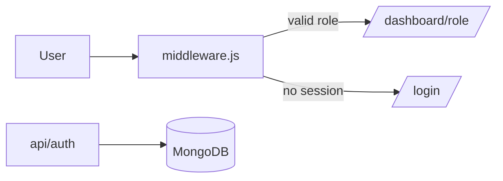

# Case study: Civil Engineering Portal

## Overview
A web portal for a civil engineering department: a public site plus separate dashboards for students, teachers and admins.

## The problem
The department needed one place for its public information and a private area where each role sees only what it should.

## What I built
- Public pages: home, about, lecturer directory and student directory
- Register, login, logout and session API routes
- Role based dashboards for student, teacher and admin
- MongoDB models for users, lecturers, announcements and results
- A seed script for admin accounts, since admins cannot self register

## How it works
Next.js 16 App Router in JavaScript, with MongoDB through Mongoose. On login, a signed JWT (jose) goes into an httpOnly cookie and passwords are hashed with bcrypt. `src/middleware.js` checks the cookie and keeps each role inside its own `/dashboard/<role>` section.

## Challenges and how I solved them
- **Keeping roles apart.** Checks run in middleware before a page loads, so a student cannot open a teacher route.
- **Safe sessions.** The token sits in an httpOnly cookie, out of reach of page scripts.
- **No open admin signup.** Admins are created by a seed script only.

## Outcome
Live on Vercel with CI on lint and build. Auth and roles work end to end. Dashboard data features such as results upload and announcements are the next step. <!-- add real metric if available -->

## Links
- Live: civil-engineering-port.vercel.app
- Code: github.com/emmybest19/civil-engineering
